# PocketPad

**Trois applications qui fonctionnent ensemble pour jouer à vos jeux PC avec votre téléphone, et sur votre TV :**

| Appareil | Application | Rôle |
| --- | --- | --- |
| Téléphone | **PocketPad** (`PocketPad-Android.apk`) | Le téléphone devient une vraie manette : DualSense, Xbox, Switch Pro, GameCube… en tactile, avec vibrations. |
| PC Windows | **PocketPad Hub** (`PocketPad-Hub-Setup.exe`) | Crée de vraies manettes Xbox 360 que tous les jeux reconnaissent, lance vos jeux et diffuse l'écran vers la TV. |
| Android TV / Google TV | **PocketPad TV** (`PocketPad-TV.apk`) | Affiche l'écran du PC en direct, lance les jeux, et transmet au PC les manettes branchées sur la TV. |

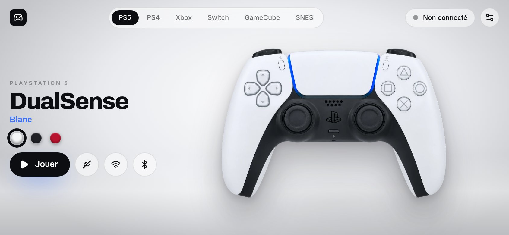

## Téléchargement

**[Dernière version](https://github.com/Trdgi4djyds/pocketpad/releases/latest)**, compilée automatiquement par GitHub Actions.

| Fichier | À installer sur |
| --- | --- |
| [`PocketPad-Android.apk`](https://github.com/Trdgi4djyds/pocketpad/releases/latest/download/PocketPad-Android.apk) | le téléphone (Android 7+, Bluetooth : Android 9+) |
| [`PocketPad-TV.apk`](https://github.com/Trdgi4djyds/pocketpad/releases/latest/download/PocketPad-TV.apk) | la TV (Android TV, Google TV, Chromecast avec Google TV, Shield…) |
| [`PocketPad-Hub-Setup.exe`](https://github.com/Trdgi4djyds/pocketpad/releases/latest/download/PocketPad-Hub-Setup.exe) | le PC Windows 10/11 : installateur (pilote ViGEmBus et pare-feu inclus) |
| [`PocketPad-Hub-Portable.exe`](https://github.com/Trdgi4djyds/pocketpad/releases/latest/download/PocketPad-Hub-Portable.exe) | le PC Windows : version portable |

## Démarrage rapide

1. **PC** : installez `PocketPad-Hub-Setup.exe` et répondez **Oui** au pilote **ViGEmBus**.
2. **Téléphone** : installez l'APK, choisissez votre manette, touchez l'icône **Wi-Fi** : le PC apparaît tout seul. Touchez-le, puis **Jouer**.
3. **TV** : installez `PocketPad-TV.apk`, choisissez le PC, puis **Bureau** ou un jeu.

## Le téléphone : la manette

| Vitrine | En jeu |
| --- | --- |
| 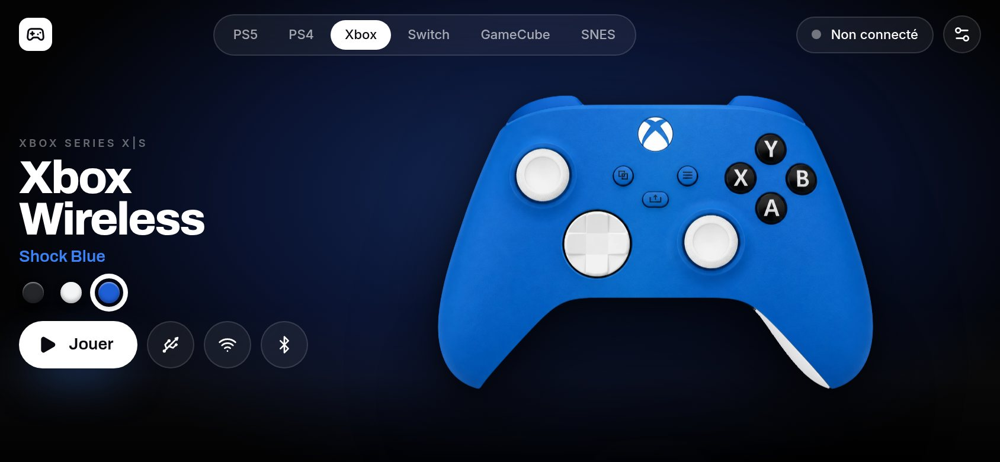 | 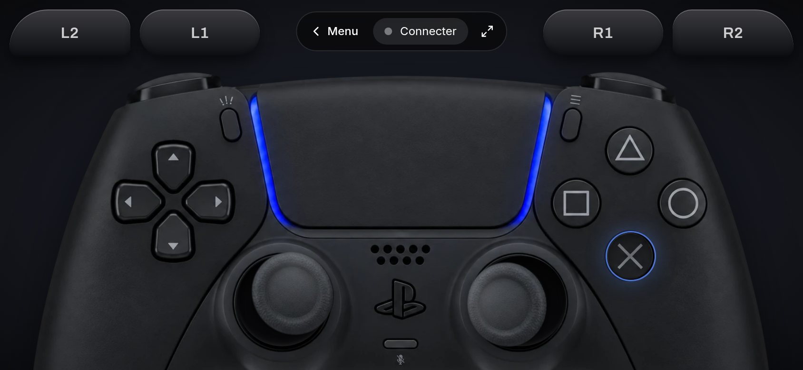 |
| 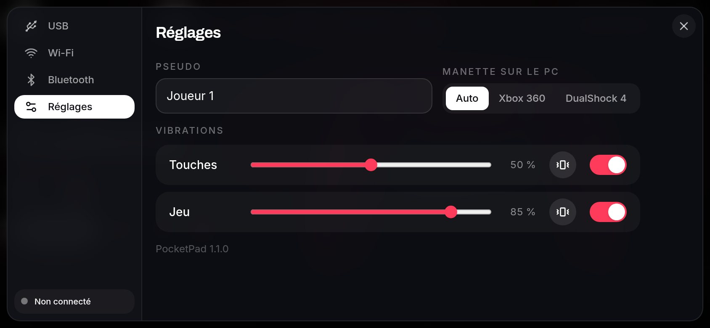 | 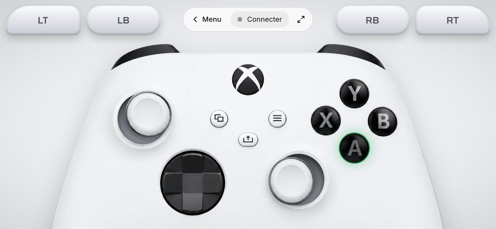 |

- **6 manettes, 11 coloris** en rendus studio neufs, vus de face : DualSense (Blanc, Midnight Black, Cosmic Red), DualShock 4 (Jet Black, Glacier White), Xbox Series (Carbon Black, Robot White, Shock Blue), Pro Controller Switch, GameCube Indigo, Super Nintendo.
- **Sticks analogiques réalistes** : le capuchon glisse et s'incline au-dessus de son logement, avec l'ombre et le dôme visibles ; clic L3 / R3 par pression brève.
- **Vibrations réglables** : touches et jeu séparément, avec intensité et bouton d'essai. Les vibrations du jeu (moteurs de la manette) sont rejouées avec leur intensité réelle.
- **Connexion** : Wi-Fi (PC trouvés automatiquement), câble USB, Internet (code PIN) ou Bluetooth.

## Le PC : PocketPad Hub

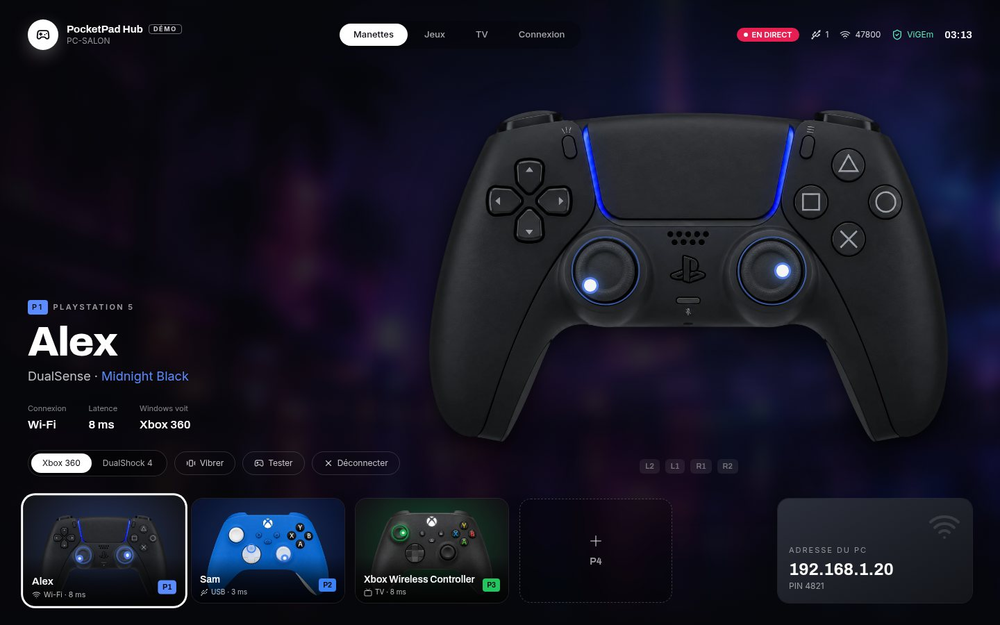

- Jusqu'à **4 joueurs** (téléphones, manettes de la TV, Bluetooth), chacun affiché avec ses touches en direct.
- **Vraie manette Windows** via ViGEmBus : **Xbox 360** par défaut (reconnue par tous les jeux), DualShock 4 au choix.
- **Relais Bluetooth** : un téléphone appairé en Bluetooth devient lui aussi une manette Xbox 360.
- Bouton **Vibrer** pour tester les vibrations, **Tester** pour ouvrir le panneau Windows des manettes.

| Jeux | TV |
| --- | --- |
| 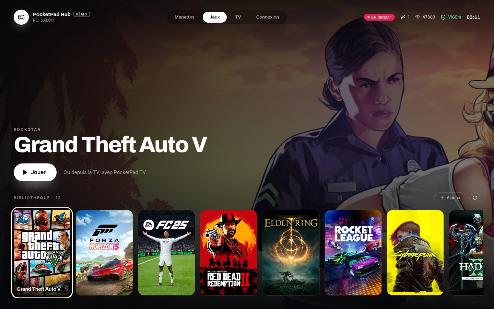 | 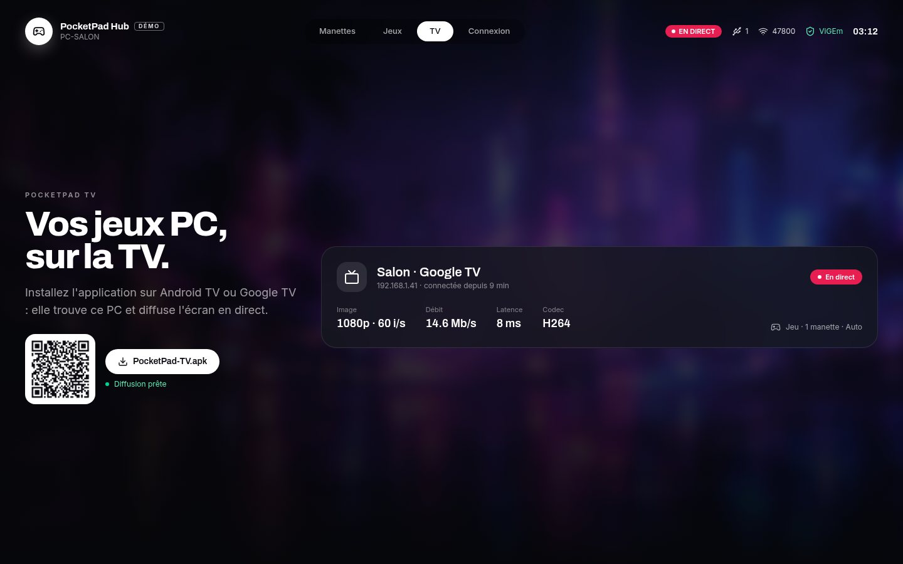 |

- **Bibliothèque** : jeux Steam, Epic Games et Rockstar détectés automatiquement, ajout manuel d'un `.exe`, lancement en un clic (ou depuis la TV).
- **Diffusion vers la TV** : écran entier et son du PC, avec résolution, images par seconde, débit et latence de chaque TV.

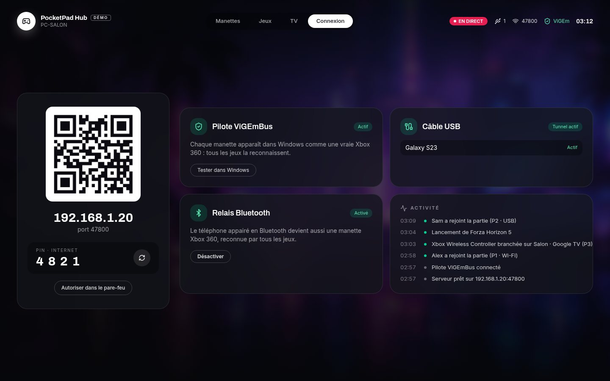

## La TV : PocketPad TV

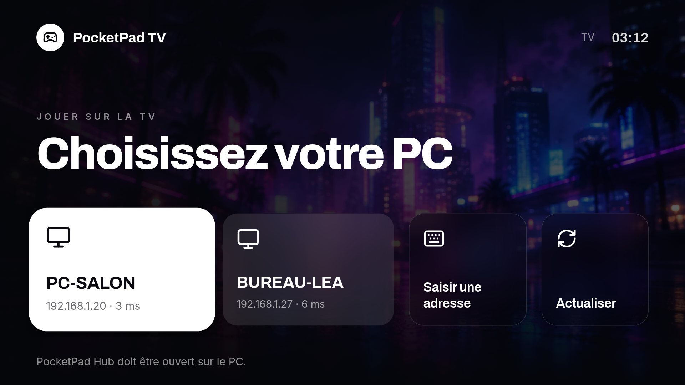

| Écran du PC | Diffusion en direct |
| --- | --- |
| 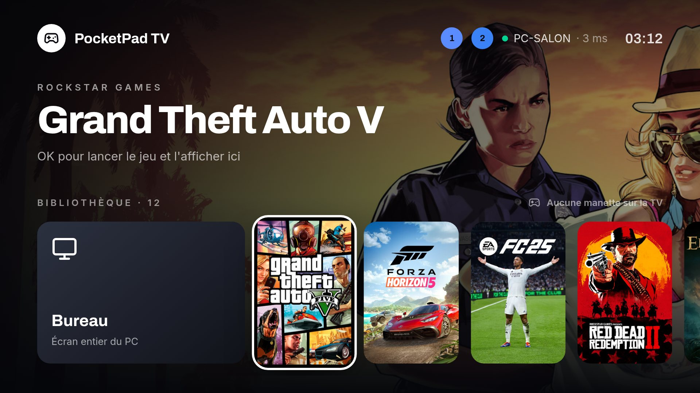 | 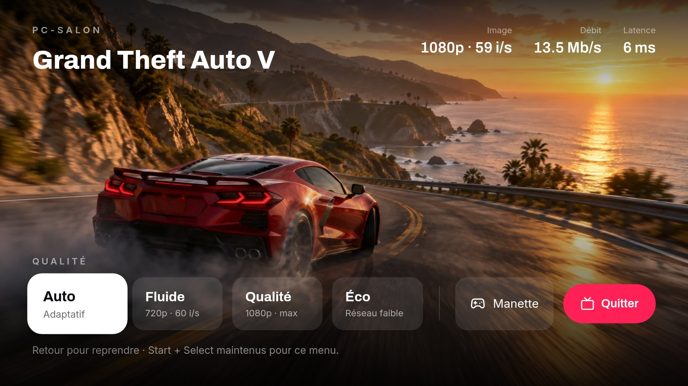 |

- **Trouve le PC tout seul** sur le réseau (ou saisie de l'adresse à la télécommande).
- **Bureau** : tout l'écran du PC ; la manette pilote la souris (stick gauche : curseur, A : clic, B : clic droit, stick droit : défilement, Start : menu Démarrer, Select : clavier visuel).
- **Jeux** : choisissez un jeu, il se lance sur le PC et s'affiche sur la TV.
- **Manettes branchées sur la TV** (Bluetooth ou USB : Xbox, DualSense, DualShock 4, Switch Pro…) : elles deviennent des manettes Xbox 360 sur le PC, vibrations comprises. La télécommande sert aussi de manette simple (croix et OK).
- **Faible latence, même sur un réseau faible** : WebRTC en UDP, H.264 décodé par la TV, débit adapté en continu, aucune mise en tampon côté TV, et commandes envoyées sans retransmission (une touche n'est jamais retardée par une image perdue).
- **Menu de diffusion** (Retour, ou Start + Select maintenus) : qualité Auto, Fluide (720p 60 i/s), Qualité (1080p) ou Éco (réseau faible), mode Manette / Souris, statistiques, Quitter.

Pour la meilleure fluidité : PC relié à la box en Ethernet, TV en Wi-Fi 5 GHz ou en Ethernet.

## Jouer à GTA V (ou n'importe quel jeu PC) pas à pas

GTA V, comme la plupart des jeux PC, n'accepte que les **manettes Xbox** (XInput) : c'est PocketPad Hub qui crée cette manette.

1. **PC** : installez `PocketPad-Hub-Setup.exe` et acceptez le pilote **ViGEmBus**. Dans le Hub, l'écusson **ViGEm** doit être vert.
2. **Téléphone** : PocketPad › icône **Wi-Fi** › touchez votre PC (ou **USB** avec le débogage USB activé). En **Bluetooth**, gardez le Hub ouvert : le relais Bluetooth crée la manette Xbox 360.
3. **Hub** : votre joueur apparaît avec « Windows voit : **Xbox 360** ». Appuyez sur des touches du téléphone : elles s'allument sur l'image.
4. **Tester** ouvre *Contrôleurs de jeu* : **Controller (XBOX 360 For Windows)** doit être listé.
5. **Lancez GTA V** (depuis l'onglet **Jeux** du Hub ou depuis la TV) et touchez un bouton : le jeu passe en mode manette.

| Problème | Solution |
| --- | --- |
| Le téléphone ou la TV ne trouve pas le PC | Même réseau, réseau Windows en « Privé », Hub › Connexion › **Autoriser dans le pare-feu**. |
| Rien dans *Contrôleurs de jeu* | Pilote ViGEmBus absent : bandeau orange du Hub › **Installer**, puis redémarrez le Hub. |
| « Windows voit : DualShock 4 » | Cliquez sur **Xbox 360** dans le Hub (ou app › Réglages › Xbox 360). |
| Manette en double dans un jeu (Bluetooth) | Désactivez le relais Bluetooth (Hub › Connexion) ou utilisez le Wi-Fi. |
| Image saccadée sur la TV | Menu de diffusion › **Fluide** ou **Éco** ; PC en Ethernet ; Wi-Fi 5 GHz. |
| Écran noir sur la TV pendant un jeu | Passez le jeu en « Plein écran fenêtré » (sans bordure). |
| GTA V version Steam | Steam › GTA V › Propriétés › Manette : laissez « Par défaut ». |

## Architecture

```
Téléphone : PocketPad                       PC Windows : PocketPad Hub                       TV : PocketPad TV
┌──────────────────────────┐  WebSocket    ┌─────────────────────────────────┐   WebRTC    ┌────────────────────────┐
│ manette tactile          │ ────────────▶ │ serveur HTTP + WebSocket        │ ──────────▶ │ vidéo + son en direct  │
│ vibrations dosées        │ ◀── rumble ── │ manettes virtuelles (ViGEmBus)  │ ◀── canal ─ │ manettes de la TV,     │
└──────────────────────────┘ USB/Wi-Fi/Web │ jeux Steam / Epic / Rockstar    │  de données │ télécommande           │
             │                             │ diffuseur (capture écran + son) │             └────────────────────────┘
             └── Bluetooth HID ──▶ relais ─│ souris / clavier (mode bureau)  │──▶ Jeux (Xbox 360)
                                           └─────────────────────────────────┘
```

| Dossier | Contenu |
| --- | --- |
| `src/mobile/` | Application téléphone : vitrine, connexion, manette jouable `PhotoPad.tsx`, vibrations |
| `src/tv/` | Application TV : choix du PC, bibliothèque, diffusion (`receiver.ts`), navigation à la télécommande |
| `src/pc/` | Interface de PocketPad Hub et diffuseur WebRTC (`Streamer.tsx`) |
| `src/shared/` | Protocole commun, catalogue des manettes (images + position de chaque bouton), pont natif, découverte des PC |
| `android/` | Projet Android (Capacitor) : saveurs `phone` et `tv`, plugins natifs `PocketPadPlugin` (vibrations, manettes, Retour) et `BluetoothGamepadPlugin` |
| `desktop/` | Programme Electron du Hub : serveur, ViGEm, jeux, relais Bluetooth, souris, ADB, installateur |
| `.github/workflows/build.yml` | Compile les deux APK et le logiciel Windows, teste, puis publie la release |

## Développement

```bash
pnpm install
pnpm dev                  # aperçu des trois applications dans leur appareil
pnpm build:apps           # téléphone + TV → out/mobile, Hub → out/pc

# APK Android (téléphone et TV)
pnpm exec cap sync android
cd android && ./gradlew assembleDebug   # app-phone-debug.apk et app-tv-debug.apk

# Logiciel PC
mkdir -p desktop/app && cp -r out/mobile out/pc desktop/app/
cd desktop && npm install
npm start                 # lance PocketPad Hub
npm run selftest          # auto-test : manettes, TV, signalisation, souris, Bluetooth
npm run dist:win          # installateur Windows
```

## Sécurité

- Aucun identifiant n'est stocké dans le dépôt. Les connexions venant d'Internet exigent le code PIN du Hub.
- Le diffuseur n'accepte que les connexions locales au PC ; la vidéo ne transite jamais par un serveur tiers.

Les noms de manettes et de jeux sont cités à titre descriptif. PocketPad n'est affilié à aucun constructeur ni éditeur.
