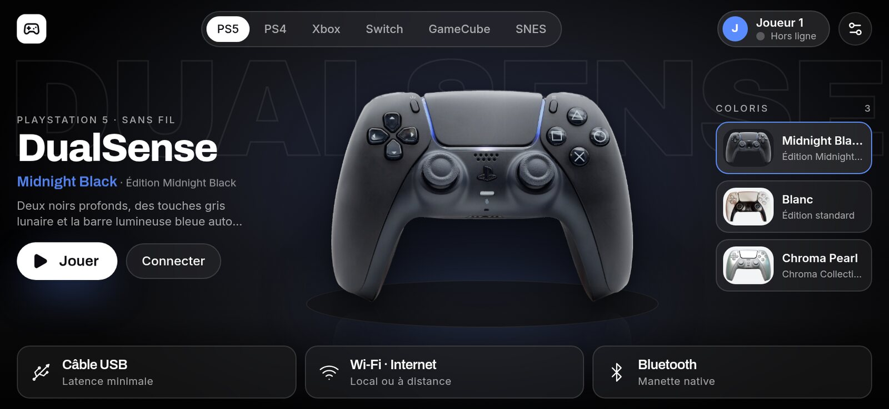
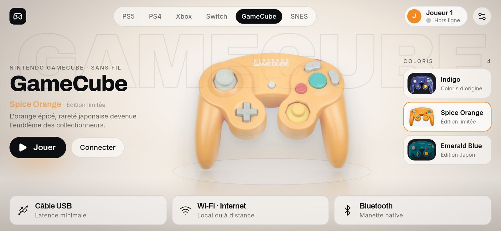
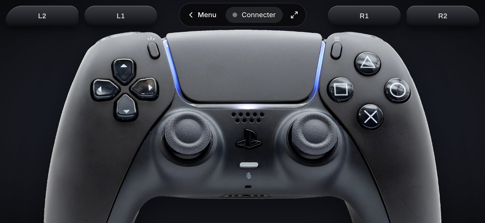
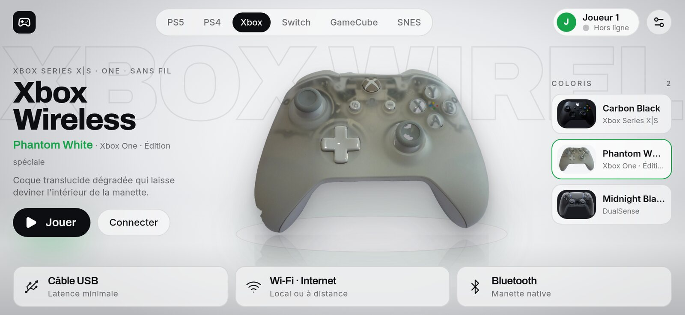
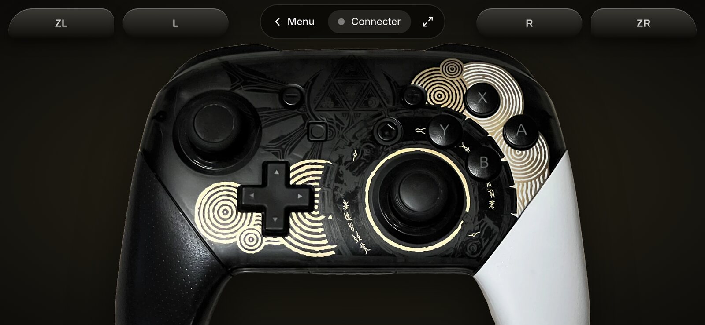
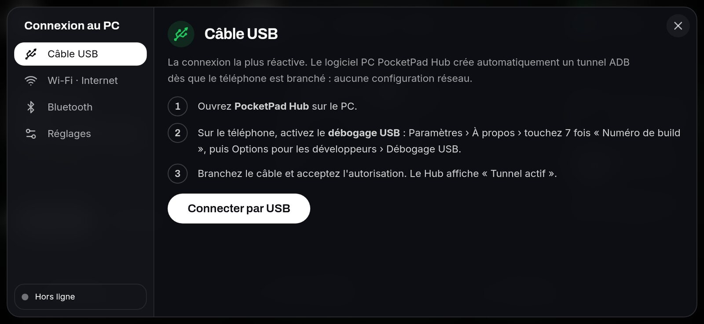
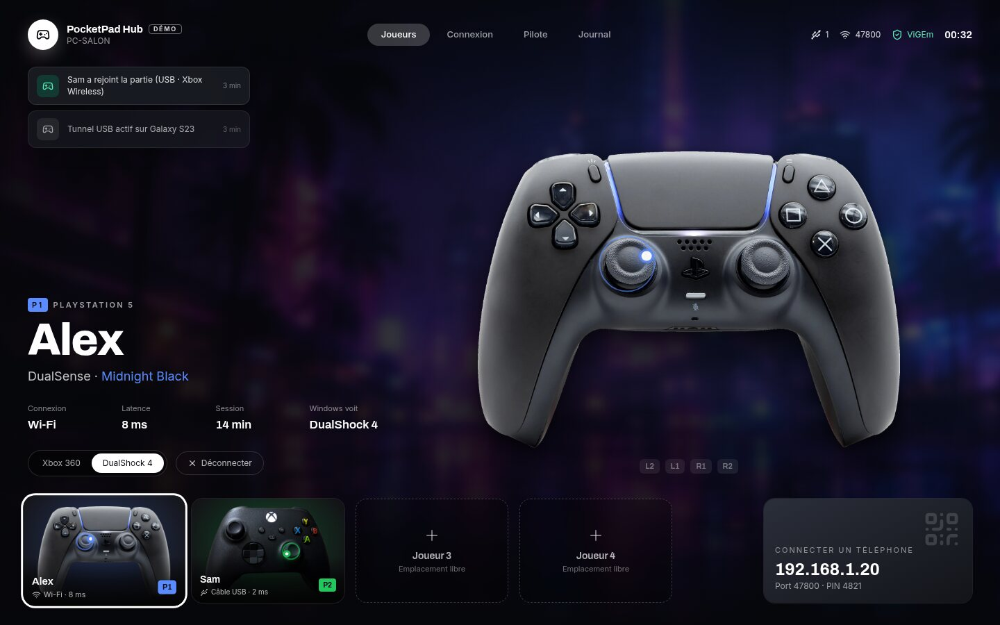
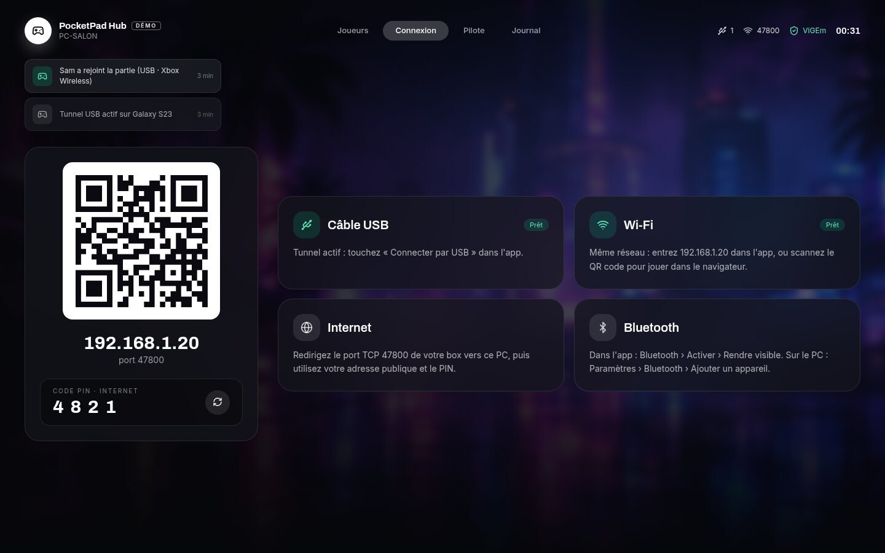

# PocketPad

**Deux logiciels qui fonctionnent ensemble pour jouer à vos jeux PC avec votre téléphone :**

| Appareil | Logiciel | Rôle |
| --- | --- | --- |
| Téléphone | **PocketPad** — APK Android | Transforme le téléphone en manette. Vous choisissez une vraie manette (photos réelles) et vous jouez en tactile. |
| PC | **PocketPad Hub** — logiciel PC Windows (installable) | Reçoit les téléphones par câble USB, Wi-Fi ou Internet et crée de vraies manettes Xbox 360 / DualShock 4 que les jeux reconnaissent. |

En Bluetooth, le téléphone est directement reconnu par Windows comme une manette, sans logiciel PC.



## Téléchargement

**[Dernière version](https://github.com/Trdgi4djyds/pocketpad/releases/latest)** — compilée automatiquement par GitHub Actions.

| Fichier | À installer sur |
| --- | --- |
| `PocketPad-Android.apk` | le téléphone (Android 7+, mode Bluetooth : Android 9+) |
| `PocketPad-Hub-Setup.exe` | le PC Windows 10/11 — installateur (propose le pilote ViGEmBus) |
| `PocketPad-Hub-Portable.exe` | le PC Windows — version portable |

## L'application Android (la manette)

De vraies photos de manettes, détourées, sur lesquelles chaque zone tactile correspond au bouton réel :

| Vitrine | En jeu |
| --- | --- |
|  |  |
|  |  |

- **6 manettes, 14 coloris réels** : DualSense (Midnight Black, Blanc, Chroma Pearl), DualShock 4, Xbox Wireless (Series Carbon Black, One Phantom White), Pro Controller Switch (Noir, Zelda), GameCube (Indigo, Spice Orange, Emerald Blue, Smash Bros.), Super Nintendo (PAL, US).
- **Multi-touch** : sticks analogiques dont le capuchon suit le doigt, clic L3/R3 par pression brève, croix 8 directions, glissement d'un bouton à l'autre, gâchettes et tranches, pavé tactile, vibrations.
- **Connexion** : câble USB, Wi-Fi, Internet (code PIN) ou Bluetooth HID.



## Le logiciel PC (PocketPad Hub)



- Jusqu'à **4 joueurs**, chacun affiché avec sa manette et **ses boutons en direct**.
- **Vraie manette Windows** via le pilote ViGEmBus : Xbox 360 (XInput) ou DualShock 4, au choix par joueur.
- **USB automatique** : le Hub embarque ADB et crée le tunnel `adb reverse` dès qu'un téléphone est branché.
- **QR code** pour jouer depuis le navigateur du téléphone sans rien installer, **code PIN** pour l'accès Internet, vibrations du jeu renvoyées au téléphone.



## Démarrage rapide

1. **PC** : installez `PocketPad-Hub-Setup.exe` et acceptez le pilote **ViGEmBus**. Au premier lancement, autorisez PocketPad Hub dans le pare-feu Windows (réseau privé).
2. **Téléphone** : installez `PocketPad-Android.apk` (autorisez l'installation depuis une source inconnue).
3. Dans l'app, choisissez votre manette et son coloris, puis **Connecter au PC** :
   - **USB** : activez le *débogage USB* (Paramètres › À propos › 7 appuis sur « Numéro de build », puis Options pour les développeurs), branchez le câble, touchez « Connecter par USB ».
   - **Wi-Fi** : saisissez l'adresse affichée par le Hub (ex. `192.168.1.20`).
   - **Internet** : adresse publique du PC (port TCP 47800 redirigé sur la box) + code PIN du Hub.
   - **Bluetooth** : « Activer la manette Bluetooth » › « Rendre visible », puis sur le PC : Paramètres › Bluetooth › Ajouter un appareil.
4. Touchez **Jouer**.

> Le mode Bluetooth expose une manette générique (DirectInput) : pratique pour Steam et les émulateurs, mais **GTA V et les jeux Xbox ne la reconnaissent pas**. Pour eux, utilisez l'USB ou le Wi-Fi avec le Hub.

## Jouer à GTA V (ou n'importe quel jeu PC) pas à pas

GTA V, comme la plupart des jeux PC, n'accepte que les **manettes Xbox** (XInput). Il faut donc passer par **PocketPad Hub** en **USB** ou en **Wi-Fi** : c'est lui qui crée la manette Xbox 360 virtuelle que le jeu reconnaît.

1. **Sur le PC** : installez `PocketPad-Hub-Setup.exe` (pas la version portable pour la première fois) et répondez **Oui** à l'installation du pilote **ViGEmBus**. Ouvrez PocketPad Hub : le bandeau orange « Pilote ViGEmBus absent » ne doit pas apparaître.
2. **Sur le téléphone** : ouvrez PocketPad › **Connecter au PC** :
   - **USB (recommandé)** : débogage USB activé, câble branché, autorisez le PC sur le téléphone, puis « Connecter par USB » ;
   - **Wi-Fi** : même réseau que le PC, saisissez l'adresse affichée dans le Hub. Si rien ne se passe : Hub › Connexion › **Autoriser dans le pare-feu**.
3. **Dans le Hub** : votre joueur apparaît. Vérifiez « Windows voit : **Xbox 360** » (sinon cliquez sur *Xbox 360*). Appuyez sur des touches du téléphone : elles s'allument sur la photo.
4. Cliquez sur **Tester dans Windows** : la fenêtre *Contrôleurs de jeu* doit lister **Controller (XBOX 360 For Windows)**. Ouvrez *Propriétés* : les boutons et sticks doivent réagir.
5. **Lancez GTA V** et appuyez sur une touche ou bougez un stick : le jeu passe aussitôt en mode manette.

| Problème | Solution |
| --- | --- |
| Connecté en **Bluetooth**, GTA V ne réagit pas | Normal : le Bluetooth expose une manette générique que GTA V ignore. Utilisez USB ou Wi-Fi avec le Hub. |
| Rien dans *Contrôleurs de jeu* | Pilote ViGEmBus absent : Hub › Pilote › Installer, puis redémarrez le Hub. |
| « Windows voit : DualShock 4 » | Cliquez sur *Xbox 360* dans le Hub (ou app › Réglages › Xbox 360). |
| Le téléphone ne trouve pas le PC en Wi-Fi | Même réseau Wi-Fi, réseau Windows en « Privé », bouton *Autoriser dans le pare-feu*. |
| GTA V version Steam | Steam › GTA V › Propriétés › Manette : laissez « Par défaut ». |

## Architecture

```
Téléphone : APK PocketPad                         PC Windows : PocketPad Hub
┌───────────────────────────────┐   WebSocket   ┌──────────────────────────────┐
│ manette tactile (photo réelle)│ ────────────▶ │ serveur HTTP + WebSocket     │──▶ ViGEmBus ──▶ Jeux
│ Capacitor + plugin Bluetooth  │  USB (adb) /  │ ADB, PIN, 4 joueurs          │   Xbox 360 / DS4
└───────────────────────────────┘  Wi-Fi / Web  └──────────────────────────────┘
               │                ◀── vibrations ──
               └──────────── Bluetooth HID (sans Hub) ────────────▶ Windows
```

| Dossier | Contenu |
| --- | --- |
| `src/mobile/` | **APK** : vitrine, connexion, manette jouable `PhotoPad.tsx` |
| `src/pc/` | **Logiciel PC** : interface de PocketPad Hub |
| `src/shared/` | Protocole commun, catalogue des manettes (photos + position de chaque bouton) |
| `android/` | Projet Android (Capacitor) + plugin natif `BluetoothGamepadPlugin` / `HidGamepad` |
| `desktop/` | Programme Electron du Hub : serveur, manettes virtuelles ViGEm, tunnel ADB, installateur |
| `.github/workflows/build.yml` | Compile l'APK et l'installateur Windows, puis publie la release |

## Développement

```bash
pnpm install
pnpm dev                  # aperçu des deux logiciels dans leur appareil
pnpm build:mobile         # APK     → out/mobile
pnpm build:pc             # PC      → out/pc

# APK Android
pnpm exec cap sync android
cd android && ./gradlew assembleDebug

# Logiciel PC
mkdir -p desktop/app && cp -r out/mobile out/pc desktop/app/
cd desktop && npm install
npm start                 # lance PocketPad Hub
npm run selftest          # auto-test du serveur
npm run dist:win          # installateur Windows
```

## Crédits et sécurité

- Photos des manettes : Wikimedia Commons, sous licences libres. Auteurs et licences dans [CREDITS.md](CREDITS.md).
- Aucun identifiant n'est stocké dans le dépôt. Les connexions venant d'Internet exigent le code PIN du Hub.

Les noms de manettes sont cités à titre descriptif. PocketPad n'est affilié à aucun constructeur.
